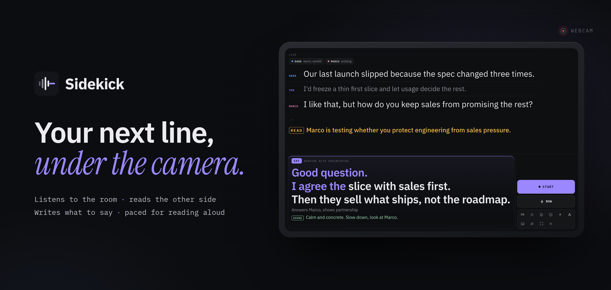
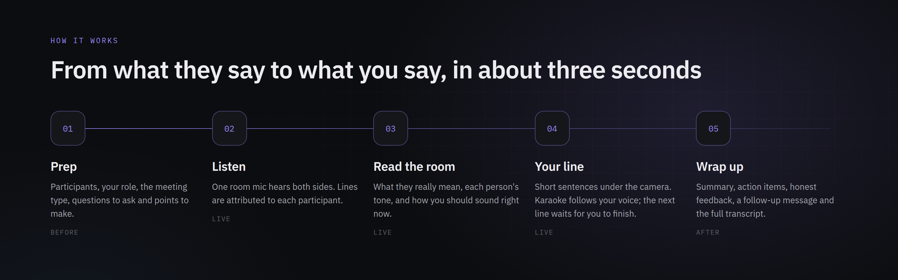
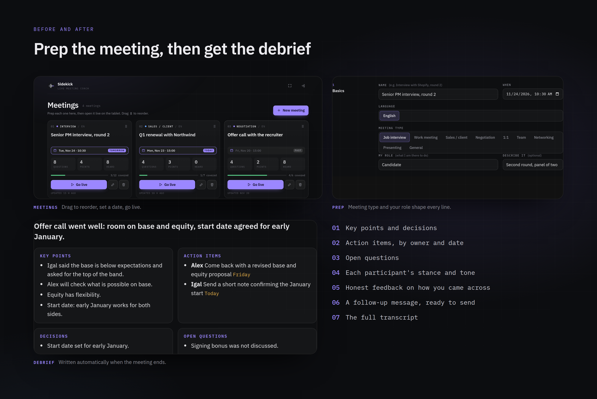

  

> **This is a showcase repository.** The source code is private. This page explains what Sidekick does and how it is built.

## What it is

In a video meeting your eyes belong on the camera, not on your notes. Sidekick turns the tablet next to my webcam into a teleprompter that listens.

It hears both sides of the meeting, reads what the other side really means, and writes the next thing to say, right under the camera. As I read it aloud, the words light up like karaoke, and the next line waits until I finish my sentence.

## From what they say to what you say

1. **Prep.** The participants, my role, the meeting type (interview, sales, negotiation, 1:1 and more), questions to ask and points to make.
2. **Listen.** One room mic hears everyone. Each line is attributed to a participant, so a panel of three stays readable.
3. **Read the room.** What they just signalled, each person's tone, and how I should sound right now ("Slow down, warm, look at Marco").
4. **Your line.** One to three short sentences, written for the ear, with up to two alternatives. A fast model updates the line in about three seconds while a fuller pass tracks the checklist in parallel.
5. **Wrap up.** When the meeting ends, a debrief is written automatically.

## Built for the moment you're on camera

- **Paced for reading aloud.** Short sentences, one per row. The line follows my voice word by word, and a new suggestion never yanks away the sentence I'm in the middle of.
- **Adapts when I go off script.** It judges by meaning, so a paraphrase counts as said and the next line continues from what I actually said.
- **Hands off.** During the meeting I only touch the large buttons in the corner. The layout is resizable before the call, the text refits to whatever space it gets, and the sides flip when the camera is on the other side.
- **Translation on demand.** The other side's lines can be glossed into my language in a small strip; my own lines are never translated.
- **Prepared words win.** If my prep contains an exact answer for a situation, it appears verbatim.

## Before and after

The debrief holds the key points, decisions, action items by owner and date, open questions, each participant's stance, honest feedback on how I came across, and a follow-up message ready to send. The full transcript sits next to it.

## At a glance

| | |
| --- | --- |
| **Stack** | Node.js with no dependencies · a single-page web app (PWA) · Docker |
| **AI** | Claude Haiku for the live line and the read · Claude Sonnet for the debrief · structured JSON output |
| **Speech** | In-browser speech recognition, multilingual |
| **Device** | Android tablet next to the webcam: wake lock, full screen, installable |
| **Hosting** | Self-hosted, private network, password login |
| **Status** | Working · voice-based speaker identification is next |

## About

Sidekick is my own project. I'm Igal Taflev, and I put AI to work and keep it accountable. More at [taflev.com](https://taflev.com) and on [LinkedIn](https://www.linkedin.com/in/igal-taflev).

Happy to show it live in a conversation.
